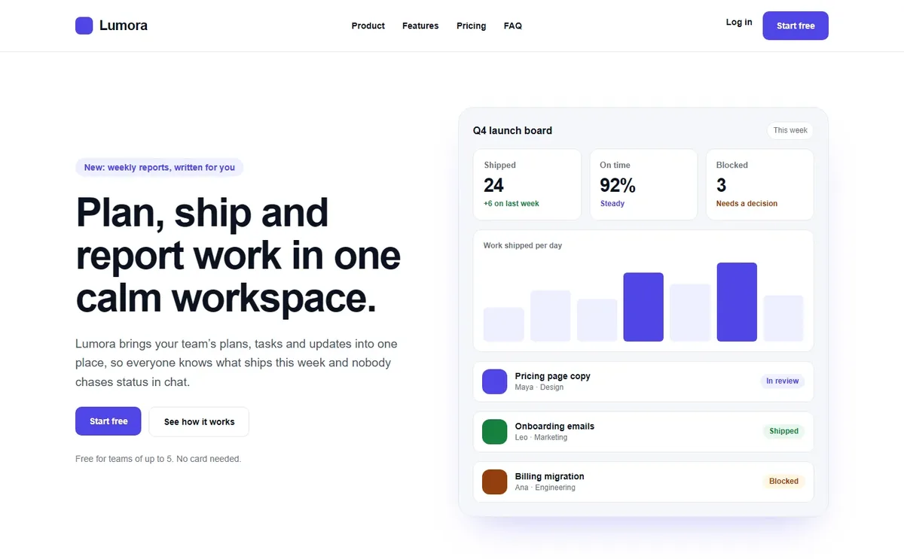
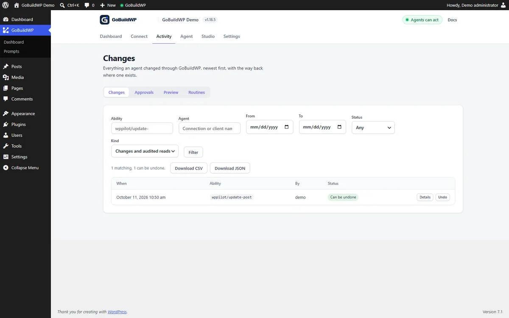
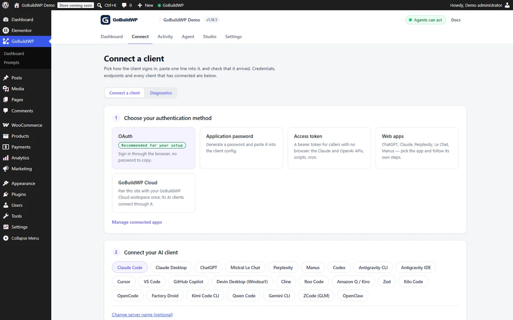
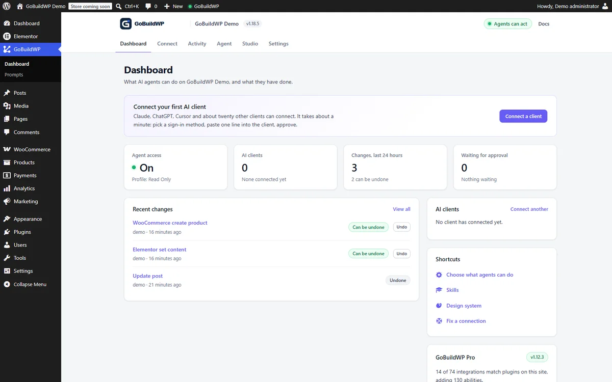

# GoBuildWP: WordPress MCP server and AI website builder for Claude, ChatGPT, Cursor and Codex

<!-- current-releases:start -->
Current releases: **GoBuildWP Free 1.18.8 / Pro 1.13.0**. Pro requires Free 1.18.1 or newer; that minimum is not the latest Free release.
<!-- current-releases:end -->

[](https://github.com/gobuildwp/wordpress-mcp-ai-gobuildwp/releases)
[](https://github.com/gobuildwp/wordpress-mcp-ai-gobuildwp/actions/workflows/quality.yml)
[](https://wordpress.org/)
[](https://wordpress.org/)
[](https://www.php.net/)
[](LICENSE)

[](https://github.com/gobuildwp/wordpress-mcp-ai-gobuildwp/releases/latest/download/gobuildwp.zip)

**GoBuildWP turns your WordPress site into an MCP server.** Connect Claude, ChatGPT, Claude Code, Codex, Cursor or any other MCP client, and an AI agent can build and edit pages, Elementor layouts, Gutenberg blocks, menus, media and SEO metadata, check PageSpeed and security, and read your WooCommerce store, all through typed WordPress abilities that your user permissions, a safety profile and an undoable change ledger still govern. The free plugin in this repository is a complete WordPress MCP server and a free Elementor MCP server. [GoBuildWP Pro](https://gobuildwp.com/pro) adds WooCommerce writes, the other page builders, SEO suites, safe updates and backups. [GoBuildWP Cloud](https://app.gobuildwp.com) is an optional hosted link for many sites.

> **GoBuildWP was previously called WPPilot.** It is the same plugin, with the same slug and settings, and existing installs keep working.

Website: <https://gobuildwp.com> · Docs: <https://gobuildwp.com/docs> · Client setup guides: <https://gobuildwp.com/wordpress-mcp> · Release notes and build demos on X: <https://x.com/gobuildwp>

---

## What's new in 1.18.8

- **Works with strict MCP clients when ACF Pro is active.** ACF Pro's native no-input abilities declare a `"type": "null"` input schema, which made Cloudflare MCP Portals and other strict clients reject the whole tool list. Both transports now serve an empty object schema for them, and calling them with `{}` works.
- **Safety hints on the modern transport.** `tools/list` now carries `readOnlyHint`, `destructiveHint`, `idempotentHint` and `openWorldHint`, as the legacy adapter did.
- **Pro: custom premium WordPress themes with AI.** Describe the site to ChatGPT, Claude or your AI IDE and it writes a real classic or hybrid theme: PHP templates, CSS and JavaScript you own. GoBuildWP Pro keeps it as a managed project with source review, an isolated private preview, approved installation and activation, and recovery that never overwrites newer content. How it works: <https://gobuildwp.com/ai-wordpress-theme-builder> · Watch Claude build an animated agency theme: <https://www.youtube.com/watch?v=KJk96c-XW4c>

## What's new in 1.18.7

- **Build a whole Elementor page in one call.** `wppilot/elementor-build-page` takes the page as one nested description (`{type, settings, styles, children}`) on v3 containers or v4 atomic elements. The whole page is validated before anything is written, so a rejected widget never leaves a half-built page; the error carries that widget's compact schema so the agent can fix it in the next call. `dry_run=true` checks a description without touching the page, and the build is one undoable change.
- **Style edits no longer wipe a layout.** `wppilot/elementor-edit-element` now merges styles property by property within the same breakpoint and state. Before, one small edit such as right-aligning a row deleted the row's other desktop styles and every tablet, mobile and hover variant.
- **Clearer errors.** Block-note abilities say "No note has that ID" instead of "Permission denied" for an ID that does not exist, and `wppilot/import-media-url` names the host and the real HTTP status when a site refuses a download.
- **Pro 1.13.0: whole websites in Elementor.** Plan every page and the menu in one checked call (`elementor-plan-site`), build the pages as drafts in short, resumable batches with a cross-page design review (`elementor-build-site`), then publish them with the front page and menu after a person approves (`elementor-publish-site`). Pages use the Elementor Canvas template by default, so the theme does not print a second header and page title above each page. The whole site, publish included, is one undo on the Changes screen.

Tested on WordPress 7.1 with Elementor 4.3.5 over a real MCP connection: every free read-only ability and the write abilities with their undo, a full landing page from one `elementor-build-page` call, and a three-page Pro site planned, built, published and rendered. Full history: [CHANGELOG.txt](CHANGELOG.txt).

## What GoBuildWP does

GoBuildWP is a self-hosted **WordPress MCP server** built on the WordPress Abilities API and the official WordPress MCP Adapter. AI clients discover, inspect and run *typed* WordPress abilities through a compact three-tool interface instead of loading hundreds of one-off endpoints into context.

It is a control layer, not an AI wrapper. **No AI model is bundled**: your MCP client brings its own model access, and policy is enforced on your own server. The free plugin needs no licence, key or account.

What an agent can do with the free plugin alone:

- **Build and edit the site**: posts and pages, Gutenberg block content, block-theme templates, template parts, global styles and patterns, menus and menu locations, the front page, media with alt text, a site-wide header, and taxonomies.
- **Edit Elementor pages**: read the element tree, then add, edit, move, duplicate, reorder and delete elements. This is a free Elementor MCP server, with no Pro install needed.
- **Design to a system**: typed design tokens, saved designs, and checks that grade a built page for contrast, composition and layout.
- **Audit and fix**: WCAG 2.2 accessibility audits, content audits for broken links, orphan pages and missing meta descriptions, search and replace with undo, and an Elementor editability score.
- **Check site health**: Google PageSpeed Insights with no Google key needed, configuration-security checks, a log of PHP fatal errors, and status from your backup and security plugins.
- **Read WooCommerce, SEO and form plugins**: store reads plus a single-product editor, per-post SEO title, description and robots in seven SEO plugins, and form entries with contact details redacted.
- **Undo**: every supported write is recorded and can be undone one change at a time, as a batch, or as a whole agent session.

**You do not have to phrase prompts in a particular way.** A client's first call is discovery. GoBuildWP answers with every ability registered on your install, plus a catalogue of the skills available for them, so "rebuild the pricing page and keep our spacing" already pulls in the right build skill, the element schemas and your design tokens.

GoBuildWP also ships a **prompt library** in wp-admin: ten complete landing-page briefs, one per industry. Each has its own palette, type pairing, design signature and content facts, so a bakery and a law firm do not come out as the same page. Pick Elementor or the block editor and the brief is written for it. [GoBuildWP Pro](https://gobuildwp.com/pro) adds 300 more industry briefs.

### Example: editing an Elementor page from Claude Code

This is an illustration of the sequence an agent follows, not a recorded transcript. You type:

> On the About page, change the hero heading to "Family law in Leeds since 1998" and point the hero button at /contact.

The agent then makes these calls on your site:

| Step | Ability | What happens |
| --- | --- | --- |
| 1 | `wppilot/elementor-check-setup` | Confirms Elementor is active and which element model (v3 widgets or v4 atomic) the install offers. |
| 2 | `wppilot/elementor-find-elements` | Finds the hero heading and the button on the About page by their text. |
| 3 | `wppilot/elementor-edit-element` (twice) | Changes the heading text and the button link in place, validated against the widget schema. The rest of the page is untouched. |
| 4 | `wppilot/elementor-clear-document-cache` | Regenerates Elementor's CSS for the page. |

Both edits are checked against your WordPress capabilities and the active safety profile before they run. They appear on **GoBuildWP → Changes**, attributed to the agent that made them, and `wppilot/undo-session` (or **Undo session** on that screen) reverses them.

### Real results: full pages built through GoBuildWP

Each page below was built from one plain-language request through the real MCP, in native Elementor, saved as a draft and checked on desktop and mobile. Nothing was edited by hand afterwards. Full pages and the exact requests: [gobuildwp.com](https://gobuildwp.com/).

| SaaS homepage (Lumora) | Car showroom (Noir Motor House) | Bakery (Hearth & Crumb) |
|---|---|---|
|  |  |  |
| 250 Elementor elements, checked at 1440 and 390 px | 130 elements, checked at 1920 to 390 px | 295 elements, checked at 1920 to 390 px |

**Inside WordPress:** every change an agent makes is listed with a way back, and each site shows what is connected.

| Changes and undo | Connect your AI client | Dashboard |
|---|---|---|
|  |  |  |

### How it compares to other WordPress MCP servers

WordPress MCP servers differ most in what happens *after* an agent writes: who confirms a destructive call, whether a change can be undone, and whether the server runs on your own site or through someone else's relay. GoBuildWP runs on your site, can require a person rather than the model to confirm destructive calls, and verifies every undo against the recorded before-image instead of assuming it worked.

[Best WordPress MCP servers](https://gobuildwp.com/compare/wordpress-mcp-servers) · [vs Respira](https://gobuildwp.com/compare/respira-vs-gobuildwp) · [vs Easy MCP AI](https://gobuildwp.com/compare/easy-mcp-ai-vs-gobuildwp) · [vs EMCP](https://gobuildwp.com/compare/emcp-vs-gobuildwp) · [vs Elementor's MCP](https://gobuildwp.com/compare/elementor-mcp-vs-gobuildwp) · [vs WPVibe](https://gobuildwp.com/compare/wpvibe-vs-gobuildwp) · [vs Royal MCP](https://gobuildwp.com/compare/royal-mcp-vs-gobuildwp) · [vs AI Engine](https://gobuildwp.com/compare/ai-engine-mcp-vs-gobuildwp) · [vs the WordPress MCP Adapter](https://gobuildwp.com/compare/wordpress-mcp-adapter-vs-gobuildwp) · [Undo and rollback, compared](https://gobuildwp.com/wordpress-mcp/undo-rollback)

## What the free plugin can do

233 registered abilities, plus one MCP prompt per skill you save. The WooCommerce, SEO, form, backup, security and Site Kit abilities register only while their plugin is active, and developer abilities only under Developer Full Access, so a fresh install with none of those plugins registers 167 on the default profile. Each ability can be switched off individually on the Abilities screen.

<details>
<summary><strong>Full table of free abilities by domain</strong></summary>

| Domain | Abilities | What it covers |
| --- | --- | --- |
| **Content** | `8` | List, search and read posts, pages and public custom post types. Create, update, trash, restore, and permanently delete with explicit confirmation. |
| **Taxonomies** | `7` | Discover taxonomies, list and read terms, create, update, delete with confirmation, and assign terms to content. |
| **Media** | `10` | List, read, import from a URL, search openly-licensed stock, update metadata and alt text, set and clear featured images, attach and detach, delete with confirmation. |
| **Comments** | `6` | List and read with commenter email and IP withheld below `moderate_comments`. Reply, edit, approve, hold, spam, unspam, trash, restore, delete with confirmation. |
| **Menus** | `10` | Create, rename and delete menus, add, update, reorder and remove items, list theme locations and assign menus to them. |
| **Revisions** | `3` | List with autosaves distinguished, read against the live post, and restore. |
| **Users** | `4` | Privacy-minimized reads. Login name, roles and registration date need `list_users`; the email address needs `edit_users`. |
| **Site** | `2` | Site information and an explicit settings allowlist. |
| **Plugins and themes** | `12` | Search the WordPress.org plugin directory and read one extension in detail. Activate, deactivate, update and switch themes with explicit confirmation. Install and delete are Developer Full Access only: they write executable code to the server. |
| **Gutenberg** | `11` | Block-editor content, staged pending changes and browser finalization for native blocks. |
| **Elementor** | `18` | Read a document, inspect the widgets and style properties this install offers, build a whole page from one description, and edit the element tree: add, edit, move, duplicate, reorder and delete. Page settings included. [Detail below.](#elementor-mcp-free-elementor-editing) |
| **Design system** | `19` | Typed design tokens, saved designs and activation, plus the checks that grade a built page against them: contrast, composition, layout grammars and a rendered-page verification pass. |
| **Preview** | `8` | Compute what a write would change without performing it, then apply the reviewed result. Plus a view link, so an agent with a browser can look at the page it built, including a draft, and a capture store that compares two screenshots of a page and reports which regions moved. |
| **Skills** | `4` + prompts | Reusable skills and site-wide instructions. Each saved skill also registers one MCP prompt, so this grows with the skills you write. |
| **Changes** | `8` | Read the redacted change ledger, attributed to the agent credential that made each write, export it as rows for a client report or an audit, roll a change back, and undo or redo everything one agent session did. |
| **Diagnostics** | `5` | Scoped health, performance and configuration-security checks, a Connection Doctor that finds what blocks an MCP client and names the fix, and a site issues log: the PHP fatal errors behind "There has been a critical error", with the file and plugin they came from, plus paused plugins, rolled-back updates and failed backups. |
| **Search and replace** | `4` | Preview a search-and-replace across posts and their meta (serialized and builder JSON included) as a reviewed plan, apply only posts unchanged since, 100 per call or as a background job, cancel it, and undo one post or the whole run. |
| **Media and accessibility** | `5` | Resize, crop, rotate or flip an image as a copy or in place, with undo. Audit a served page against WCAG 2.2, find images with missing or filename alt text, show an image to the model so it can write real alt text, and set alt text in bulk with undo. |
| **Content audit** | `2` | Broken internal links, orphan pages, thin content, missing SEO descriptions and structured-data problems across the site, as a background job. |
| **Builder quality** | `1` | Score how editable an Elementor page is, 0-100, and list per element what to fix: layout in HTML widgets, scripts, shortcodes, inline styles, custom CSS, fixed colours instead of the global palette, deep nesting and empty containers. |
| **Block themes** | `11` | Global Styles, templates and template parts (list, read, save, revert to the theme file), the site's own synced and unsynced patterns, and block navigation menus, all through WordPress's own REST controllers and all undoable. |
| **Site header** | `1` | Build the site-wide header: logo and title, the menu (a menu button on tablets and phones), a language dropdown, an optional button and the cart, one header per Polylang language. It checks the served header before reporting success and can be undone. Needs Elementor Pro (Elementor's own paid plugin), or a block theme. |
| **Block Notes** | `4` | Leave a note on a block for a person, reply, resolve, and read the notes they resolved. Every one can be undone. |
| **Site tools** | `8` | WP-Cron list, run and delete (undoable), Site Health tests, transient flush, and, on Developer Full Access and audited, an options explorer and a read-only database SELECT with redaction. |
| **Multisite** | `2` | List a network's sites and run an ability on one of them through that site's own safety profile and gates. Loads only on a multisite network. |
| **WooCommerce** | `13` | Check the setup, list and read products, variations, categories, tags and store settings, read orders and customers, and edit one product's name, description, prices and stock with undo. |
| **SEO** | `14` | One post's SEO title, meta description and robots in Yoast SEO, Rank Math, All in One SEO, SEOPress, The SEO Framework, Slim SEO and SmartCrawl, read and set with undo. |
| **Forms** | `8` | List the forms of WPForms, Contact Form 7, Gravity Forms and Forminator and read their entries with email addresses, phone numbers and sensitive fields withheld. |
| **Backups and security** | `5` | Backup status and history (UpdraftPlus, Duplicator, BackWPup, All-in-One WP Migration); security plugin status, scan findings and lockouts with IPs shown as networks (Wordfence, Solid Security). |
| **Page speed** | `2` | Google PageSpeed Insights for any page of the site (Lighthouse scores, lab metrics, Core Web Vitals field data and the biggest opportunities) with no Google key needed. With Site Kit by Google active, turn on its read-only dashboard sharing for Administrators, undoably. |
| **Scheduled audits** | `5` | Routines that run the accessibility, content and alt-text audits on a schedule, store each report, compare it with the last and email what changed. |
| **Developer** | `13` | PHP execution, WP-CLI, filesystem and temporary admin access. Blocked outside Developer Full Access, and excluded entirely from the WordPress.org build. |

</details>

Content creation is draft-first: an absent, blank or malformed status resolves to `draft` before any capability check, so nothing is published by accident.

## Learn: videos and guides

- **Video: build a custom WordPress theme with Claude and GoBuildWP Pro.** From a creative brief to Afterglyph, an animated agency theme with GSAP and ScrollTrigger: site connection, the brief, private preview, approval and content editing. <https://www.youtube.com/watch?v=KJk96c-XW4c>
- **AI WordPress theme builder (Pro):** how the managed theme workflow goes from brief to installed theme. <https://gobuildwp.com/ai-wordpress-theme-builder>
- **Connect your AI client:** step-by-step setup for ChatGPT, Claude, Cursor and other MCP clients. <https://gobuildwp.com/wordpress-mcp>
- **Documentation and ability reference:** <https://gobuildwp.com/docs>
- **Release notes and build demos on X:** <https://x.com/gobuildwp>

## Quick setup

### 1. Install the plugin

1. [**Download `gobuildwp.zip`**](https://github.com/gobuildwp/wordpress-mcp-ai-gobuildwp/releases/latest/download/gobuildwp.zip) and upload it in **Plugins → Add New → Upload Plugin**. The folder inside the archive is `wppilot/`, so the plugin installs as `wp-content/plugins/wppilot`. That is its internal id, kept so existing installs update in place.
   *GitHub's own "Source code (zip)" download is **not** installable: it has no `vendor/` and uses a versioned folder name. Older versions are on the [releases page](https://github.com/gobuildwp/wordpress-mcp-ai-gobuildwp/releases).*
2. Activate GoBuildWP.
3. Open **GoBuildWP → Configuration** and leave **Production Safe** selected.
4. Open **GoBuildWP → Connect** and choose your AI client. The screen generates the exact configuration for that client, with your site's URL and a suggested server name (`gobuildwp-<your-site>`) filled in.

The MCP endpoints:

```text
https://example.com/wp-json/mcp/wppilot         # application passwords and access tokens
https://example.com/wp-json/mcp/wppilot-oauth   # OAuth clients
```

The older `/wp-json/mcp/mcp-adapter-default-server` route still resolves as a legacy alias, but new configurations should use the paths above.

### 2. Connect your AI client

Replace `example.com` with your site and `gobuildwp-example` with any name you like. Hosted web apps (Claude on the web, ChatGPT and the Codex desktop app) connect from their own servers, so the site must be reachable over public HTTPS.

**Claude Code** (WordPress MCP for Claude Code)

```bash
claude mcp add gobuildwp-example --transport http https://example.com/wp-json/mcp/wppilot-oauth
```

Then run `/mcp` inside Claude Code and complete the browser sign-in.

**Claude on the web and Claude Desktop.** On the web, open **Customize → Connectors → Add custom connector**. In Claude Desktop, open **Settings → Connectors → Add custom connector**. Paste `https://example.com/wp-json/mcp/wppilot-oauth` and sign in. The Connect screen also offers a `.mcpb` bundle for Claude Desktop.

**ChatGPT** (WordPress MCP for ChatGPT). Open **Settings → Apps → Advanced settings → Developer mode**, then **Create app**, and use the OAuth URL above. This needs ChatGPT on the web and a site on public HTTPS. To reach several sites from ChatGPT through one link, use [GoBuildWP Cloud](#gobuildwp-cloud-every-site-behind-one-mcp-link).

**Codex CLI**

```bash
codex mcp add gobuildwp-example --url https://example.com/wp-json/mcp/wppilot-oauth
codex mcp login gobuildwp-example
```

In the **Codex desktop app**, open Settings from your account menu, add the URL as a remote MCP server and approve the browser sign-in.

**Cursor**: use the one-click button on the Connect screen, or add this to `~/.cursor/mcp.json` or `.cursor/mcp.json`:

```json
{
  "mcpServers": {
    "gobuildwp-example": { "url": "https://example.com/wp-json/mcp/wppilot-oauth" }
  }
}
```

**VS Code and GitHub Copilot**: add this to `.vscode/mcp.json` (VS Code 1.101 or later). Copilot CLI reads `mcpServers` instead, and the Connect screen generates that file too.

```json
{
  "servers": {
    "gobuildwp-example": { "type": "http", "url": "https://example.com/wp-json/mcp/wppilot-oauth" }
  }
}
```

**Everything else.** The Connect screen also writes configuration for Gemini CLI and Qwen Code (which want `httpUrl`), Antigravity and Devin Desktop, formerly Windsurf (which want `serverUrl`), Factory Droid, Zed, Cline, Roo Code, Kilo Code, Amazon Q, OpenCode, OpenClaw, Kimi Code CLI, ZCode (GLM), Mistral Le Chat, Perplexity and Manus. Which route each takes: [`docs/ai-client-compatibility.md`](docs/ai-client-compatibility.md). Per-client guides: <https://gobuildwp.com/wordpress-mcp>.

**Scripts, cron and APIs.** The Claude Messages API MCP connector, the OpenAI Responses API `mcp` tool, automation platforms and `curl` use an access token, `Authorization: Bearer wpp_…`, on the canonical `/wp-json/mcp/wppilot` endpoint.

**Same machine, no credential (stdio).** A client running on the same machine as the site can start the MCP server itself over WP-CLI, with the same abilities, safety profile and confirmations:

```bash
claude mcp add gobuildwp-local -- wp --path=/var/www/html wppilot mcp serve --user=admin
```

Cursor and other clients that take a command can run `wp` with the arguments `--path=/var/www/html wppilot mcp serve --user=admin`. The Connect screen shows these with your path and login filled in.

### Authentication

Three methods, all chosen on **GoBuildWP → Connect**. None of them is a product licence.

- **OAuth 2.1 with PKCE**, recommended wherever the client can open a browser. Access tokens last 1 hour and refresh tokens 14 days, and every authorization is listed under **Connected Apps** so it can be revoked on its own. Client ID Metadata Documents are the preferred registration mechanism; RFC 7591 dynamic client registration remains as a fallback.
- **Application Passwords**, for clients that cannot run a browser flow. Sent as HTTP Basic.
- **Access tokens** for callers with no browser. Created with an optional expiry, shown once, stored only as a SHA-256 digest and revocable per token. A token borrows the capabilities of the user who created it, re-checked on every request, so demoting or deleting that user closes the token immediately.

### MCP protocol support

GoBuildWP serves both protocol revisions during the migration window: the stateless `2026-07-28` revision (no `initialize` and no session; each request carries its version and client capabilities in `_meta`) and the legacy `2025-11-25` revision through the bundled MCP Adapter. Existing clients do not need to reconnect. `server/discover` advertises both. **MCP Tasks shipped in Free 1.15.0 on the modern transport**; it is on by default and can be disabled with the `wppilot_mcp_tasks_enabled` filter; cancelling a task does not undo writes it already completed. Full detail: [`docs/wordpress-mcp.md`](docs/wordpress-mcp.md).

## Free vs Pro vs Cloud

**Free** is this repository. **Pro** is a separate paid plugin that runs on top of Free (Free 1.18.1 or newer, and an active licence or trial). **Cloud** is an optional hosted gateway: every tool a site offers (Free, plus Pro where it is installed) is reachable through it, so the Cloud column lists only what Cloud itself adds. A dash means that edition adds nothing for that row.

| Capability | Free | Pro | Cloud |
| --- | --- | --- | --- |
| **Full website creation and editing** | **Free**: pages, posts, Gutenberg blocks, menus, front page, media, taxonomies, design system, block-theme templates and parts, site-wide header, a whole Elementor page in one call | **Pro**: whole multi-page Elementor websites planned, built, published and undone as one job, Elementor Theme Builder templates and display conditions, page builder and theme modules | **Cloud**: the same site tools for many sites through one link |
| **Landing pages** | **Free**: 10 industry landing-page briefs, built in Elementor or the block editor | **Pro**: 300 more industry briefs, built with design-spec roles and section grammars | — |
| **Elementor editing** | **Free**: 18 editing abilities, whole-page build included (Elementor 3.6+; Elementor Pro not required) | **Pro**: 52 more: composition, templates, popups, forms, dynamic tags, global classes and variables. Theme Builder and form features need Elementor Pro, Elementor's own paid plugin | — |
| **Gutenberg and blocks** | **Free**: block content, staged block batches, block themes (global styles, templates, patterns, navigation), Block Notes | **Pro**: GenerateBlocks, Kadence Blocks, Spectra and Spectra One modules (each needs that plugin) | — |
| **Other page builders** | — (Free refuses writes that a builder would ignore, instead of reporting a false success) | **Pro**: Bricks, Divi, Oxygen, Beaver Builder, Breakdance, WPBakery, Etch, Mosaic, Flatsome UX Builder (each needs that builder) | — |
| **WooCommerce** | **Free**: 13 abilities: catalogue, store, order and customer reads, and one product's name, description, prices and stock with undo (WooCommerce 9.0+) | **Pro**: 50 more: create and delete products, full product editing, bulk prices and stock, orders, refunds, coupons, store settings, sales reports | — |
| **SEO** | **Free**: one post's SEO title, description and robots in 7 SEO plugins; site content audit (broken links, orphans, missing descriptions) | **Pro**: focus keywords, canonicals, social previews, schema, redirects, bulk SEO, reviewable content-fix plans | **Cloud + Pro**: SEO report from Search Console, read through each site's Site Kit |
| **PageSpeed and performance** | **Free**: PageSpeed Insights (Lighthouse, Core Web Vitals) with no Google key; performance health checks | **Pro**: cache plugin abilities (purge, settings, warm, measure) and step-by-step PageSpeed fix plans that re-measure after each change | **Cloud**: answers the free PageSpeed check when Site Kit cannot, no account needed |
| **Security checks** | **Free**: configuration-security checks; Wordfence and Solid Security status, scan findings and lockouts | **Pro**: hardening plan you confirm, applied with before-and-after checks and rollback; IP block and unblock; start scans | — |
| **Updates** | **Free**: update plugins and themes with explicit confirmation (recorded, not reversible) | **Pro**: safe updates: backup check, before-and-after page checks, automatic rollback, undo for 7 days | **Cloud**: see pending updates (sites on Free 1.18.0+). **Cloud + Pro**: start updates from Cloud |
| **Backups** | **Free**: status and history from UpdraftPlus, Duplicator, BackWPup and All-in-One WP Migration | **Pro**: start a backup (UpdraftPlus, BackWPup, All-in-One WP Migration; not Duplicator); optionally refuse risky calls until a fresh backup exists | **Cloud**: see backup status. **Cloud + Pro**: start backups from Cloud |
| **Forms** | **Free**: list forms and read redacted entries (WPForms, Contact Form 7, Gravity Forms, Forminator) | **Pro**: build and edit forms in eight form plugins, full entry values, exports | — |
| **Custom fields, multilingual, LMS, events** | — | **Pro**: ACF, Meta Box, JetEngine, Pods, ACPT, WPML, Polylang, Weglot, Tutor LMS, The Events Calendar and more | — |
| **Multi-site management** | **Free**: one site per direct connection; on a WordPress multisite network, run an ability on any network site | — | **Cloud**: up to 3 sites in one MCP link. **Cloud + Pro**: more sites by plan, bulk actions across sites with a dry run |
| **Approvals and confirmations** | **Free**: safety profiles, per-ability switches, explicit confirmation for destructive calls, optional "a person approves" mode | **Pro**: approval queue that holds an agent's write until a person approves it, with email notification | **Cloud + Pro**: safety policies pushed to sites whose owner allows it |
| **Undo and change history** | **Free**: change ledger with agent attribution; undo one change, a batch, or a whole agent session, verified against the before-image | **Pro**: Pro writes recorded in the same ledger | **Cloud**: review and undo changes on each connected site |
| **Agent memory** | Skills and site-wide instructions | **Pro**: persistent, approved memory across conversations | — |
| **Licence and price** | GPL-2.0-or-later, no key, no account | Paid licence from [gobuildwp.com](https://gobuildwp.com/pricing) | Free account for up to 3 sites; more with a Pro licence |

[Compare Free vs Pro](https://gobuildwp.com/free-vs-pro) · [Pricing](https://gobuildwp.com/pricing) · [All integrations](https://gobuildwp.com/integrations)

## Elementor MCP: free Elementor editing

**Editing an Elementor page is free.** The Elementor abilities load automatically when Elementor 3.6 or newer is active and stay unregistered otherwise, so an agent is never offered a tool that cannot work on this site. Elementor Pro is not required.

Writing generated HTML into `post_content` does not change an Elementor page. The layout lives in postmeta as a typed element tree, and Elementor renders from that. These abilities work on the tree itself, and GoBuildWP refuses a `post_content` write to an Elementor page by name rather than reporting a success that changes nothing.

| Ability | What it does |
| --- | --- |
| `wppilot/elementor-check-setup` | Elementor and Elementor Pro versions, and whether the v4 atomic runtime, the style schema, global classes, variables and interactions are available. The call an agent should make first. |
| `wppilot/elementor-get-schema` | Discover widgets, or describe named ones compactly: which controls exist, their types and their allowed values. |
| `wppilot/elementor-get-style-schema` | The 73 style properties Elementor's atomic engine accepts, with the value shape each one takes. |
| `wppilot/elementor-get-widget-params` | The parameters one widget accepts, without reading its whole schema. |
| `wppilot/elementor-get-content` | Read the element tree of a document, as structure or in full. |
| `wppilot/elementor-find-elements` | Locate elements by type, widget, id or the text they contain. |
| `wppilot/elementor-set-content` | Replace a document's tree in one call. Invalid properties are dropped and reported; pass `strict` to refuse instead. |
| `wppilot/elementor-build-page` | Build a whole page from one nested description in one call, validated before anything is written; `dry_run` checks it without touching the page. |
| `wppilot/elementor-add-element` | Insert a widget, a container or a whole subtree at a chosen position, validated against the schema first. |
| `wppilot/elementor-edit-element` | Change one element's settings or styles in place. |
| `wppilot/elementor-move-element` | Move an element to a new parent or position. |
| `wppilot/elementor-duplicate-element` | Copy an element, with fresh ids throughout its subtree. |
| `wppilot/elementor-reorder-children` | Reorder a container's children in one call. |
| `wppilot/elementor-delete-element` | Remove an element and its subtree. |
| `wppilot/elementor-get-page-settings` · `set-page-settings` | Read and write document-level settings such as page layout, title visibility and background. |
| `wppilot/elementor-clear-document-cache` | Regenerate Elementor's CSS for a document after a write. |

Both element models are supported: Elementor v4 atomic elements (`e-div-block`, `e-heading`, `e-paragraph`, `e-button`, `e-image` and the rest) and classic v3 widgets and containers. The free plugin also includes `wppilot/elementor-audit-atomic-readiness`, which reports how much of the site uses v4 atomic elements, and `wppilot/elementor-audit-output`, which scores how editable a page is. Full detail: [`docs/elementor-mcp.md`](docs/elementor-mcp.md).

**What Pro adds on top.** Composition: whole multi-page websites (`elementor-plan-site`, `elementor-build-site`, `elementor-publish-site`) undone as one change, design-spec roles and section grammars inside `elementor-build-page`, and `elementor-compile-spec` and `elementor-build-from-spec` turn a reproduction spec into global classes and a matching tree. Reuse: templates, theme parts and display conditions, popups, global classes, v4 variables, and v3 global colours and typography. Content: Elementor Pro forms and submissions, dynamic tags, interactions and site-wide custom code. Free can build and edit an Elementor page; Pro builds the whole website. [MCP for Elementor](https://gobuildwp.com/mcp-for-elementor)

## WooCommerce MCP

**Free:** 13 WooCommerce abilities, on WooCommerce 9.0 or newer. An agent can check the store setup, list and read products, variations, categories, tags and store settings, read orders and customers (these two also need `manage_woocommerce`), and edit one product's name, description, prices and stock. The edit saves through WooCommerce, so its lookup tables and caches follow, and it can be undone from the Changes screen.

**Pro** adds 50 more: creating and deleting products, full product editing (SKU, categories, images, attributes), variable products, bulk prices and stock, order and customer writes, refunds, coupons, store settings, and sales and product-performance reports for a date range.

Every call is capability-checked against the connected WordPress user, so an agent connected as a shop manager cannot do what that account could not do by hand. Order status changes and anything touching money are classed destructive, so they need explicit confirmation and are recorded in the change ledger. Full detail: [`docs/woocommerce-mcp.md`](docs/woocommerce-mcp.md) · [MCP for WooCommerce](https://gobuildwp.com/mcp-for-woocommerce)

## Gutenberg MCP and block themes

Block editing is in the **free** plugin. An agent can read and write block-editor content, and stage changes as a pending batch. Core blocks are validated and serialised by the block editor's own JavaScript, so staged batches are finalised in a browser tab through the Block Editor Queue rather than written blind. The plugin says so instead of failing silently.

On a block theme, the free block themes abilities edit Global Styles, templates and template parts (header, footer), the site's own patterns and block navigation menus through WordPress's own REST controllers, and every change can be undone. Block Notes let an agent leave a note on a block for a person and read the ones they resolved. Pro adds modules for GenerateBlocks, Kadence Blocks, Spectra and Spectra One. [MCP for Gutenberg](https://gobuildwp.com/mcp-for-gutenberg)

## Page builder MCP servers: Bricks, Divi, Beaver Builder, Oxygen, Breakdance, WPBakery, Etch and Mosaic

One endpoint covers every builder below, and each builder registers only when it is installed. A page builder does not store a page as HTML: it stores an element tree, references to shared classes and design tokens, template rules and dynamic bindings. Writing generated markup into that store is how a layout stops opening in its own editor, so GoBuildWP gives the agent each builder's own vocabulary instead.

| Builder | Abilities | Edition | Guide |
| --- | --- | --- | --- |
| **Elementor** | **18 free** + 52 Pro | Free and Pro | [MCP for Elementor](https://gobuildwp.com/mcp-for-elementor) |
| Etch | 60 | Pro | [MCP for Etch](https://gobuildwp.com/mcp-for-etch) |
| Bricks | 49 | Pro | [MCP for Bricks](https://gobuildwp.com/mcp-for-bricks) |
| Divi | 47 | Pro | [MCP for Divi](https://gobuildwp.com/mcp-for-divi) |
| Mosaic | 41 | Pro | [MCP for Mosaic](https://gobuildwp.com/mcp-for-mosaic) |
| Oxygen | 37 | Pro | [MCP for Oxygen](https://gobuildwp.com/mcp-for-oxygen) |
| Breakdance | 33 | Pro | [MCP for Breakdance](https://gobuildwp.com/mcp-for-breakdance) |
| Beaver Builder | 21 | Pro | [MCP for Beaver Builder](https://gobuildwp.com/mcp-for-beaver-builder) |
| WPBakery | 18 | Pro | [MCP for WPBakery](https://gobuildwp.com/mcp-for-wpbakery) |
| Flatsome UX Builder | 11 | Pro | [MCP for Flatsome](https://gobuildwp.com/mcp-for-flatsome) |

- **Bricks MCP**: patches the Bricks element tree in place with `bricks-patch-elements`, so a change to one section does not rewrite the page around it.
- **Divi MCP**: works with Divi modules and global presets (`divi-apply-global-preset`) rather than flattening a layout into shortcodes.
- **Beaver Builder MCP**: Beaver Builder keeps its layout in postmeta (`_fl_builder_data`), so HTML in `post_content` changes nothing a visitor sees. Pro reads and writes that store; Free recognises the builder and refuses the write.
- **Oxygen MCP**: Oxygen renders from a JSON element tree in postmeta and ignores `post_content`. Pro works against that tree.
- **WPBakery MCP**: WPBakery keeps its layout in `post_content` as nested shortcodes. Pro parses and edits those shortcodes instead of replacing the markup around them.
- **Breakdance, Etch and Mosaic MCP**: each exposes its own element model. Etch has the largest surface of any builder in Pro.

Where each builder keeps its layout, and what that means for an agent: [`docs/page-builder-mcp.md`](docs/page-builder-mcp.md).

## WordPress SEO with an AI agent

- **Free:** read and set one post's SEO title, meta description and robots in Yoast SEO, Rank Math, All in One SEO, SEOPress, The SEO Framework, Slim SEO and SmartCrawl. Each write goes through the plugin's own storage the way its editor does, and can be undone. Where a plugin cannot store something (Slim SEO has no follow flag; SEOPress has no per-post "force index"), the ability says so. The free content audit finds broken internal links, orphan pages, thin content, missing meta descriptions and structured-data problems across the site.
- **Pro:** focus keywords, canonicals, social previews, schema, redirects and bulk SEO. `wppilot/content-fix-plan` turns audit findings into reviewable fixes (link retargets, redirects, related links for orphans, drafted meta descriptions), and `wppilot/content-fix-apply` applies only the items you choose, each as its own undoable change.
- **Cloud with Pro:** a Search Console report per site (clicks, impressions, click rate and position for top pages and queries), read through each site's own Site Kit by Google.

[WordPress AI SEO automation](https://gobuildwp.com/wordpress-ai-seo-automation)

## PageSpeed and site performance

- **Free:** `wppilot/pagespeed-check` runs Google PageSpeed Insights on any page of the site, mobile, desktop or both, and returns Lighthouse scores for performance, SEO, accessibility and best practices, lab metrics, Core Web Vitals field data and the opportunities that save the most time. No Google key is needed: Site Kit by Google answers when it can, GoBuildWP Cloud's proxy otherwise, and a key of your own is optional. Diagnostics include scoped performance checks.
- **Pro:** abilities for caching and optimization plugins (purge, read and change settings, warm and measure pages) and a PageSpeed fix loop: `wppilot/pagespeed-fix-plan` names the one cache setting that addresses the largest opportunity it can, and `wppilot/pagespeed-fix-step` applies that one setting with confirmation, purges, re-runs PageSpeed, and rolls the change back in the same call if the score dropped or something broke.

[WordPress AI speed optimization](https://gobuildwp.com/wordpress-ai-speed-optimization)

## WordPress security checks

- **Free:** configuration-security checks in Diagnostics, and read-only status from Wordfence and Solid Security: firewall mode, scan schedule and results, open findings by severity, and lockouts. IP addresses are reduced to their network, other people's logins are masked, and licence keys and secrets are never read. The site issues log records the PHP fatal errors behind "There has been a critical error on this website", with the plugin or theme they came from.
- **Pro:** `wppilot/security-harden-plan` proposes a hardening profile as current → proposed changes with reasons; `wppilot/security-apply-settings` applies it with confirmation, reads each setting back, runs checks before and after, and rolls everything back if a check regresses. Pro can also block and unblock IPs and start a scan.

## Safe updates and backups

- **Free:** activate, deactivate and update plugins and themes with explicit confirmation. Activation, deactivation and theme switches can be rolled back; updates are recorded as not reversible, with how to undo them manually. Backup status and history come from UpdraftPlus, Duplicator, BackWPup and All-in-One WP Migration, with no archive paths, download links or storage credentials returned.
- **Pro:** `wppilot/safe-update` updates one plugin or theme at a time: it requires a recent successful backup (24 hours by default), zips a rollback copy, checks the site's pages before and after, and rolls back automatically when a page breaks. A safe update can be undone for 7 days. `wppilot/backup-trigger` starts a backup in UpdraftPlus, BackWPup or All-in-One WP Migration (Duplicator is read only). An optional setting refuses destructive or critical calls until a fresh backup exists.
- **Limits:** GoBuildWP does not store backups or restore them. Starting a backup queues it in your backup plugin; it does not prove the backup completed or that it can be restored.

[WordPress AI safe updates](https://gobuildwp.com/wordpress-ai-safe-updates)

## GoBuildWP Cloud: every site behind one MCP link

The free plugin connects one site directly. **GoBuildWP Cloud** is an optional hosted account at [app.gobuildwp.com](https://app.gobuildwp.com) that puts all your sites behind one MCP link, `https://app.gobuildwp.com/mcp`, so an AI app can list your sites, discover each site's tools (including Pro tools where Pro is installed), run them, review changes and undo them.

1. Install GoBuildWP 1.17 or newer on each site.
2. In wp-admin, open **GoBuildWP → Connect → GoBuildWP Cloud**, sign in or create a free account, and choose what Cloud may do on that site: **Read only** or **Production safe**. The site creates its own access token and sends it to Cloud server to server, so it never passes through a browser.
3. Add `https://app.gobuildwp.com/mcp` to your AI app once. ChatGPT, Claude, Claude Code, Cursor, VS Code Copilot, Codex, Gemini CLI, Antigravity, Devin Desktop, Zed, Kiro, JetBrains Junie, LM Studio and Goose sign in with OAuth; Cline, scripts and CI jobs use a personal access token.

**Each site stays the final authority.** Its safety profile, confirmations, change ledger and undo apply exactly as with a direct connection, and Cloud can never exceed the access the site granted. Disconnect from either side and the token is revoked.

| | Free | With a GoBuildWP Pro licence |
| --- | --- | --- |
| Connected sites | 3 | Single Site plan: 3 · 10 Sites plan: 10 · 100 Sites plan: 100 · Unlimited Sites plan: see [pricing](https://gobuildwp.com/pricing) |
| Single-site tools, change review and undo | Yes | Yes |
| Pending updates and backup status (sites on Free 1.18.0+) | Yes | Yes |
| Start updates and backups from Cloud | — | Yes |
| Bulk actions across sites, with a dry run | — | Yes |
| Safety policies pushed to sites | — | Yes |
| SEO report (via each site's Site Kit) | — | Yes |

Cloud is included with every Pro licence. [More about Cloud](https://gobuildwp.com/cloud) · [Sign up](https://app.gobuildwp.com/register)

## GoBuildWP Pro integrations

[GoBuildWP Pro](https://gobuildwp.com/pro) adds plugin-aware abilities for 89 integrations: typed operations that understand each plugin's own data model rather than writing generic content. Modules load only when their plugin is detected, and each loads in isolation, so a missing or broken plugin cannot stop the rest from registering.

- **Page builders**: Elementor, Bricks, Breakdance, Divi, Oxygen, Beaver Builder, WPBakery, Etch, Mosaic, Flatsome UX Builder
- **Blocks and themes**: GenerateBlocks, Kadence Blocks, Spectra, Spectra One, Astra, Avada, GeneratePress, Kadence, OceanWP, Blocksy, Neve, WoodMart, WordPress block themes
- **Commerce**: WooCommerce, FunnelKit
- **Forms**: WPForms, Gravity Forms, Fluent Forms, Formidable Forms, Contact Form 7, Ninja Forms, Forminator, WS Form
- **SEO**: Yoast SEO, Rank Math, AIOSEO, SEOPress, The SEO Framework, Slim SEO, SmartCrawl, Redirection, Site Kit by Google
- **Custom data**: Advanced Custom Fields, ACPT, Admin and Site Enhancements, JetEngine, Meta Box, Pods, Dynamic Shortcodes
- **Multilingual**: WPML, Polylang, Weglot, TranslatePress
- **Backups and security**: UpdraftPlus, Duplicator, BackWPup, All-in-One WP Migration, Wordfence, Solid Security
- **Site operations**: The Events Calendar, Paid Memberships Pro, Tutor LMS, BuddyPress, Code Snippets, Bricksforge
- **Performance**: caching and optimization plugins

Pro also adds persistent agent memory, the human approval queue, a brand kit, integration health reporting (which modules loaded, which were skipped, and why) and plugin-aware skill packs.

> GoBuildWP Pro is a commercial plugin and is not distributed from this repository.

## Safety: permissions, safety profiles, approvals and undo

### Permissions

Every call runs as a WordPress user and is checked against that user's capabilities, read from each post type's and taxonomy's own capability object. On top of that, individual abilities can be switched off, any ability can be set to always require confirmation or a minimum safety profile, and writes are rate-limited per credential.

### Safety profiles

| Profile | What it allows |
| --- | --- |
| **Read Only** | Discovery and inspection. Every state-changing ability is blocked. |
| **Production Safe** (default) | Normal content, design, SEO, forms and commerce work, plus plugin activation and updates with confirmation. Blocks raw PHP, WP-CLI, filesystem, database, plugin and theme installation and deletion, and temporary admin access. |
| **Developer Full Access** | Every enabled ability, including privileged surfaces. Critical calls still require explicit confirmation. Intended for development and staging sites. |

### Confirmation and approval modes

Destructive and critical calls need explicit confirmation. **Settings → Confirmation → Confirmation mode** decides what counts:

- **Agent flag** (default): the model sends `confirm: true`.
- **A person approves**: `confirm` from the model is not enough. The person approves the exact call in their MCP client (form elicitation on the `2026-07-28` revision) or on a one-time wp-admin link that shows the ability, the account and the exact input. Each change records how it was confirmed.

Writes made through other plugins' MCP abilities (Elementor's and WooCommerce's own MCP servers among them) are recorded in GoBuildWP's change log too, and an optional setting asks for approval before they run. Pro adds an **approval queue** that holds an agent's write until a person approves it, with email notification; the agent receives a structured "pending" response, not a false success.

### Change ledger and undo

Every supported write is recorded in a redacted change ledger, attributed to the agent behind it (the OAuth client or application-password credential, plus the client name), not only to the WordPress user. A write made in wp-admin, WP-CLI or cron is recorded as `direct`.

**GoBuildWP → Changes** lists every change, filters by ability, agent, date and status, and undoes one change, one batch, or everything a filter shows. `wppilot/undo-session` takes back everything one agent session did, newest first, verifying each change against its before-image; `wppilot/redo-session` puts it back under the same checks, and `wppilot/list-sessions` shows what undo and redo would do now.

### What undo cannot do

- Only operations with a registered restore strategy can be undone. Others, such as plugin installs, updates and deletions, permanently deleted comments and started backups, are recorded as irreversible, and say why.
- Session undo refuses, without touching anything, when something else changed a target after the agent did, and names the conflict.
- Session undo stops at the first change that fails verification and reports what was undone, what failed and what was not attempted. A change that cannot be undone is listed, never silently skipped.
- Before-images stop after 1 MB per call; later items in that call say plainly that none was kept.
- Cancelling an MCP task does not undo writes it already completed. A Pro safe update can be undone for 7 days.

More: [`docs/SAFETY.md`](docs/SAFETY.md).

## FAQ

**What is a WordPress MCP server, and is this a server or a client?**
A server. Your site exposes typed WordPress abilities over MCP at `https://example.com/wp-json/mcp/wppilot`, and the AI client you already use connects to it. No model is bundled and no AI key is stored; the client brings its own model access.

**Do I need an OpenAI or Anthropic API key?**
No. Claude, ChatGPT, Cursor and the other clients use their own model access. Only the optional in-admin GoBuildWP Chat uses an AI provider configured on your WordPress site.

**Is there a free Elementor MCP server?**
Yes. This plugin registers 18 Elementor editing abilities as soon as Elementor 3.6 or newer is active, with no licence and no Pro install. Pro adds whole-page composition, templates and theme parts, popups, forms, dynamic tags, global classes and variables.

**Can an agent build a whole Elementor page with the free plugin?**
Yes, one element at a time with `elementor-add-element`, `elementor-edit-element` and `elementor-set-content`, against the palette, type scale and spacing from the free design system. The single-call page builders, `elementor-build-page` and `elementor-build-from-spec`, are Pro.

**What about Bricks, Divi, Beaver Builder, Oxygen, Breakdance, WPBakery, Etch, Mosaic and Flatsome?**
Those are GoBuildWP Pro, on the same endpoint. The builder must be installed on the site.

**Is there a WooCommerce MCP server?**
Yes. Free reads the catalogue, store settings, orders and customers and edits one product's basics with undo. Pro adds product creation, orders, refunds, coupons, bulk changes and reports.

**Is it safe to point an agent at a production site?**
That is what the safety model is for. Start on Read Only and verify one call before allowing writes. Production Safe blocks raw PHP, WP-CLI, filesystem, database and extension installation; destructive calls need confirmation, optionally from a person; WordPress capabilities still apply; and supported changes can be undone.

**Do I need Pro or Cloud?**
No. The free plugin is a complete WordPress MCP server with 233 abilities and needs no licence, activation key or account. Pro and Cloud are optional.

**How does it relate to the WordPress Abilities API and the MCP Adapter?**
It is built on both. Abilities are registered through the Abilities API, and the MCP Adapter is bundled to serve the legacy protocol revision. GoBuildWP adds authentication, safety profiles, confirmation gates, rate limiting, the change ledger with undo, and the abilities themselves.

**Is it on WordPress.org?**
Not currently. Install `gobuildwp.zip` from [Releases](https://github.com/gobuildwp/wordpress-mcp-ai-gobuildwp/releases). GoBuildWP Pro is sold at gobuildwp.com.

**Why do the CLI, endpoints and ability names still say `wppilot`?**
They are the plugin's internal identifiers (`wppilot/*` abilities, `wp wppilot`, `/wp-json/mcp/wppilot`) and were kept on purpose, so existing client configurations, scripts and installs keep working after the rename.

## Requirements

- WordPress 6.9 or newer, tested up to WordPress 7.1
- PHP 8.0 or newer
- HTTPS for any remotely reachable connection; hosted web clients cannot reach `localhost`
- Elementor abilities: Elementor 3.6 or newer, registered only while it is active. Elementor 4.0 or newer also unlocks the atomic style schema and global classes. Elementor Pro is not required for the free Elementor abilities.
- WooCommerce abilities: WooCommerce 9.0 or newer
- GoBuildWP Pro: GoBuildWP Free 1.18.1 or newer and an active Pro licence or trial
- GoBuildWP Cloud: GoBuildWP 1.17 or newer on each site (1.18.0 or newer for update and backup reporting)
- GoBuildWP Chat (optional): WordPress 7.0 and an AI provider configured through the WordPress AI Client

## Privacy

The MCP endpoint is self-hosted, and a direct connection has no GoBuildWP relay. **GoBuildWP Cloud is optional.** Only if you connect a site does it share its URL, name, versions and status with app.gobuildwp.com; Cloud stores that site's access token encrypted, and AI calls made through Cloud pass through it (Cloud logs the tool name, site, outcome and time, not page content). A site connected by an older version keeps reporting to the service's former domain until it reconnects, as described in `readme.txt`.

The PageSpeed check sends the tested page address and this site's address to GoBuildWP Cloud (or straight to Google PageSpeed Insights) when Site Kit cannot answer, even if the site is not connected to Cloud. The design preview loads chosen fonts from Google Fonts. Update checks go to gobuildwp.com and send only the plugin version. When GoBuildWP Chat is used, WordPress sends the conversation, selected attachments, site instructions, tool definitions and relevant tool results to the AI provider you configured. Every external service is listed in the *External services* section of [`readme.txt`](readme.txt). Suggested policy text is in **Settings → Privacy → Policy Guide**.

## Documentation

| Guide | |
| --- | --- |
| Getting started | <https://gobuildwp.com/docs/getting-started> |
| Connect an AI client | <https://gobuildwp.com/docs/connect-ai-client> |
| OAuth 2.1 setup | <https://gobuildwp.com/docs/oauth-setup> |
| Application Passwords | <https://gobuildwp.com/docs/application-passwords> |
| Safety profiles | <https://gobuildwp.com/docs/safety-profiles> |
| Page builder workflows | <https://gobuildwp.com/docs/page-builder-workflows> |
| Change ledger and rollback | <https://gobuildwp.com/docs/change-ledger-and-rollback> |
| Troubleshooting | <https://gobuildwp.com/docs/troubleshooting> |

In this repository:

| Document | What it covers |
| --- | --- |
| [`docs/wordpress-mcp.md`](docs/wordpress-mcp.md) | The WordPress MCP server: endpoints, protocol revisions, discovery, MCP Tasks. |
| [`docs/elementor-mcp.md`](docs/elementor-mcp.md) | The free Elementor MCP surface, the v3 and v4 element models, a read-before-write sequence. |
| [`docs/page-builder-mcp.md`](docs/page-builder-mcp.md) | Where each page builder stores a layout, and why an MCP server has to speak that store. |
| [`docs/woocommerce-mcp.md`](docs/woocommerce-mcp.md) | WooCommerce over MCP: capability checks, destructive classification, order and money handling. |
| [`docs/ai-client-compatibility.md`](docs/ai-client-compatibility.md) | Which AI clients connect how, and what each one needs. |
| [`docs/ARCHITECTURE.md`](docs/ARCHITECTURE.md) | Request lifecycle, ability registration, where the code lives. |
| [`docs/SAFETY.md`](docs/SAFETY.md) | Safety profiles, confirmation gates, rate limits, the change ledger. |

Index: [`docs/README.md`](docs/README.md)

## Support

- Connection problems: **GoBuildWP → Diagnostics** runs the checks a client runs and usually names the fix. See [troubleshooting](https://gobuildwp.com/docs/troubleshooting).
- Bugs, client connection reports and integration requests: [GitHub issues](https://github.com/gobuildwp/wordpress-mcp-ai-gobuildwp/issues).
- Help and Pro or Cloud questions: <https://gobuildwp.com/support>.
- Releases and build demos: [@gobuildwp on X](https://x.com/gobuildwp).

## Contributing

Pull requests are welcome. Read [CONTRIBUTING.md](CONTRIBUTING.md) first: it covers what to check before opening an issue, what is likely to be accepted, and how to run the tests.

## Security

Report suspected vulnerabilities privately; see [SECURITY.md](SECURITY.md). Do not open a public issue for a vulnerability, and never include production credentials or customer data.

## Licence

GPL-2.0-or-later. See [LICENSE](LICENSE) and [`LICENSES/`](LICENSES) for the full SPDX texts.
